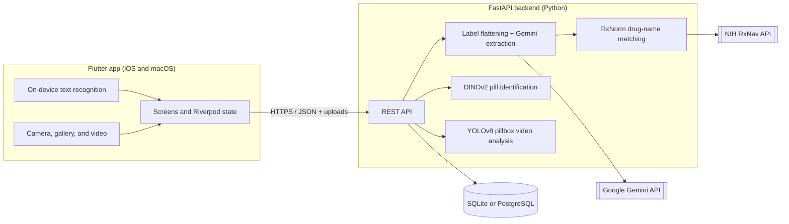

# Adhera

**Adhera helps people take the right medication at the right time, and helps their caregivers confirm it.**

Adhera is a cross-platform mobile app with a Python backend. It turns a photo of a
prescription label into a medication schedule, tracks a physical weekly pillbox,
and uses computer vision to flag when a pill appears to have been removed. A
person always reviews the result before anything is recorded.

> Built for the Congressional App Challenge.

---

## Why it matters

Missing doses, doubling up, and mixing up pills are common. They are especially
risky for older adults, people managing several prescriptions, and the family
members who care for them. The World Health Organization has reported that about
half of people with chronic conditions do not take their medication as prescribed.
Adhera makes the daily routine easier to follow and gives caregivers clear,
reviewable evidence without claiming more certainty than the technology supports.

## Features

| Feature | What the user does | What happens behind the scenes |
| --- | --- | --- |
| **Prescription label scanning** | Points the camera at a pill bottle and captures several views. | The phone reads the text on-device (Google ML Kit) and picks the sharpest frames. The backend flattens the curved label with OpenCV, then Google Gemini extracts the drug, strength, and directions as structured data. Drug names are checked against the NIH RxNorm database. |
| **Patient and caregiver review** | Edits and confirms the scanned details; a care-team member approves or rejects them. | Nothing becomes a medication until both steps are complete. Duplicate approvals are blocked. |
| **Weekly schedule** | Sets which days and times each medication is taken. | The dashboard shows today's doses as pending, taken, or missed. |
| **Pillbox inventory** | Sees what is in each compartment of a 7-day AM/PM pillbox. | A 14-slot inventory is stored per user. |
| **Alerts and care team** | Gets alerts for missed doses and invites family members or caregivers. | Missed doses appear in Home and Alerts with a configurable alert phone number. |
| **Pill identification** | Photographs a loose pill. | A DINOv2 vision model compares the photo with reference images and suggests the closest match, always marked for review. |
| **Video dose verification** | Records a short video of taking a pill from the pillbox. | YOLOv8 models find the seven compartments, count the pills in each one before and after, and report a *candidate* removal or transfer for a person to review. |

## How it works



## Tech stack

| Layer | Technologies |
| --- | --- |
| Mobile app | Flutter 3 / Dart, Riverpod (state), go_router (navigation), Dio (HTTP), camera, image_picker, Google ML Kit text recognition |
| Backend | Python 3.11+, FastAPI, Uvicorn, Pydantic v2, SQLAlchemy 2 (async), Alembic |
| Database | SQLite for local development, PostgreSQL 15 in Docker |
| Computer vision | OpenCV, Ultralytics YOLOv8 (detection and segmentation), Meta DINOv2 via PyTorch, NumPy, Pillow |
| AI and data services | Google Gemini 2.5 Flash (label extraction), NIH RxNorm / RxNav, rapidfuzz |
| Tooling | Docker Compose, pytest/unittest, flutter_test, flutter_lints, Ruff, ffmpeg (dataset preparation) |

More detail is in [docs/ARCHITECTURE.md](docs/ARCHITECTURE.md).

## Designed for safety

Medication software has to be honest about what it knows. Adhera follows these rules:

- **A person decides.** Vision results are labeled as *candidates* and always
  require review. A video showing a pill being removed does not count as proof
  the dose was taken, and it never changes inventory or adherence records.
- **No steering.** The schedule is never given to the vision models, so the
  models cannot be biased toward the answer the app expects.
- **Two-step prescription approval.** The patient confirms the scanned details
  and a caregiver approves them before a medication is created.
- **Clear limits.** The video model was trained on one specific pillbox layout
  and three medications. Results are documented openly, including failures, in
  [docs/VISION_RESEARCH.md](docs/VISION_RESEARCH.md).

## Getting started

### 1. Backend

Requires Python 3.11 or newer. From the repository root:

```bash
python3 -m venv .venv
source .venv/bin/activate
pip install -r backend_api/requirements.txt
cp backend_api/.env.example backend_api/.env   # add GEMINI_API_KEY to enable label scanning

python -m backend_api.scripts.seed_sample_schedule   # create the demo account

cd backend_api
uvicorn main:app --host 0.0.0.0 --port 8000 --reload
```

Check that it is running with `curl http://127.0.0.1:8000/health`. Interactive
API documentation is at <http://127.0.0.1:8000/docs>.

The backend uses SQLite by default. To run with PostgreSQL in Docker, see
[docs/DEPLOYMENT.md](docs/DEPLOYMENT.md).

### 2. Mobile app

Requires the Flutter SDK and Xcode. The app targets iOS and macOS:

```bash
cd mobile_app
flutter pub get
flutter run --dart-define=API_BASE_URL=http://127.0.0.1:8000
```

For a physical iPhone, use your computer's local network address instead of
`127.0.0.1`, with both devices on the same Wi-Fi.

### 3. Sign in with the demo account

| Email | Password |
| --- | --- |
| `adherasample@gmail.com` | `AdheraDemo2026` |

The demo account comes with four medications (ibuprofen, acetaminophen, iron,
and potassium) on a full weekly schedule. It always opens on a sample
Wednesday: the morning doses are taken except ibuprofen, which is missed, so
you can see the dashboard, alerts, and care-team features with realistic data.
You can also create your own account on the sign-in screen.

### 4. Optional: vision models

Pill identification downloads the DINOv2 model the first time it is used.
Video verification uses locally trained YOLOv8 checkpoints in
`backend_api/runs/`, which are not committed because of their size. Without
them, those endpoints return a clear "unavailable" message and the rest of the
app still works. See [docs/VISION_RESEARCH.md](docs/VISION_RESEARCH.md) to
reproduce training.

## Repository layout

```text
.
├── mobile_app/            Flutter app
│   ├── lib/
│   │   ├── screens/       One file per screen
│   │   ├── widgets/       Reusable UI pieces
│   │   ├── state/         Shared Riverpod state
│   │   ├── repositories/  REST API access
│   │   ├── services/      HTTP client and camera-frame analysis
│   │   └── models/        Data classes matching the API
│   └── test/              Widget and unit tests
├── backend_api/           FastAPI backend
│   ├── routers/           HTTP endpoints
│   ├── services/          Business logic, OCR, and computer vision
│   ├── models/            Database tables (SQLAlchemy)
│   ├── schemas/           API request and response shapes (Pydantic)
│   ├── scripts/           Training and support utilities
│   ├── datasets/          Reference images and lookup data
│   └── tests/             Backend tests
├── sample_data/           Development photos and videos
└── docs/                  Architecture, deployment, and research notes
```

## Testing and code quality

```bash
# Backend (from the repository root)
python -m unittest discover -s backend_api/tests

# Mobile app
cd mobile_app && flutter analyze && flutter test
```

There are 89 backend tests and 38 Flutter tests. They cover login, adherence
rules, inventory, OCR parsing, RxNorm matching, video-comparison logic, API
error handling, navigation, the camera workflow (with a simulated camera), and
the prescription approval flow. Python is formatted and linted with Ruff
(`backend_api/ruff.toml`); Dart uses `dart format` and `flutter_lints`.

## Results and limitations

- **Video verification** found the correct event in 3 of 4 reviewed development
  recordings when the before and after moments were marked by hand. Automatic
  timing did not yet succeed. These recordings were also used during
  development, so this is a progress check, not a measure of real-world accuracy.
- The video models support one pillbox layout (seven blue PM compartments) and
  three pills: acetaminophen, ibuprofen, and iron. Iron detection is unreliable.

## Roadmap

1. Save the prescription review queue and care team on the server, so they
   persist across devices and restarts.
2. Push notifications for upcoming and missed doses.
3. More training data (more sessions, lighting conditions, and "no removal"
   examples) and automatic detection of the before and after moments.
4. Database migrations for production deployments.

## Documentation

| Document | Contents |
| --- | --- |
| [Architecture](docs/ARCHITECTURE.md) | How the app, backend, database, and vision pipelines fit together |
| [Deployment](docs/DEPLOYMENT.md) | Docker, PostgreSQL, configuration, and production notes |
| [Vision research](docs/VISION_RESEARCH.md) | Dataset preparation, training, evaluation, and results for the video models |
| [Mobile app](mobile_app/README.md) | Running on simulators and devices, plus app behavior notes |
| [Backend scripts](backend_api/scripts/README.md) | Training and support utilities |
| [Sample data](sample_data/README.md) | Development media and dataset rebuilding |
| [Contributing](CONTRIBUTING.md) | Workflow, checks, and rules for secrets |

## Privacy

Never commit patient photos or videos, databases, uploads, `.env` files, or
credentials. All of these are excluded by `.gitignore`.
